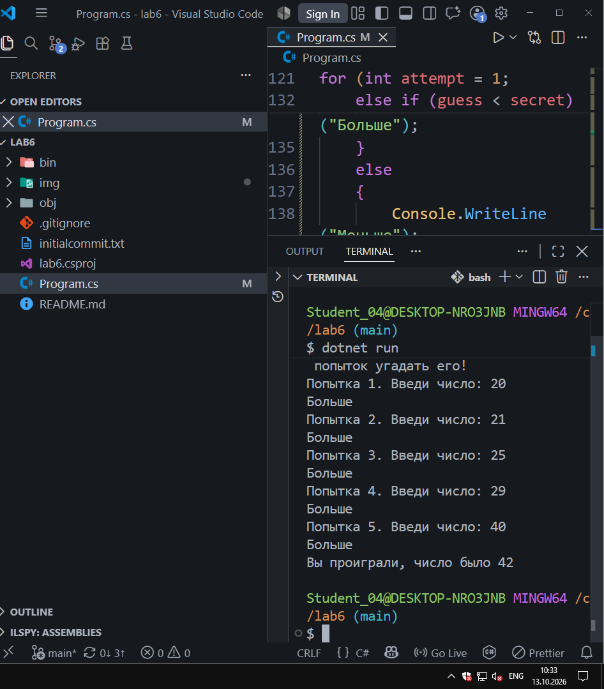

# Lab №6

**ФИО:** Чумаченко Михаил
**Группа:** ИСП-242
**Дата:** 13.10.2026

## Что изучено

- Цикл for применяется, когда количество повторений известно заранее, а в while условие проверяется до начала выполнения тела цикла.
- Цикл do while гарантирует, что тело цикла выполнится хотя бы один раз, так как проверка условия идет в самом конце.
- Оператор break полностью прерывает выполнение цикла, а continue лишь пропускает текущую итерацию и переходит к следующей.

